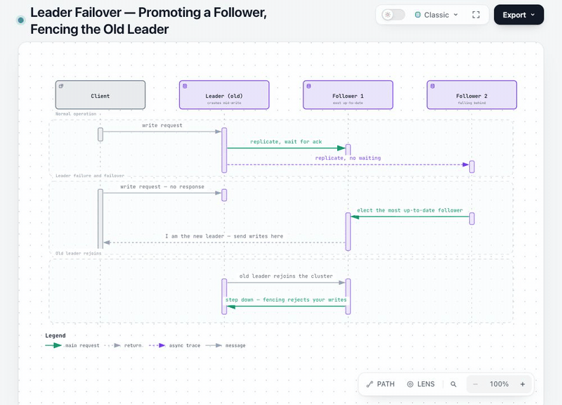
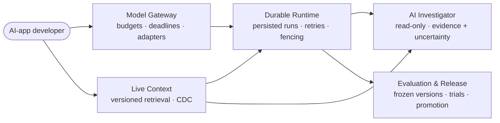

<div align="center">

# DDIA Study Lab

### Learn *Designing Data-Intensive Applications* by playing with it.

Interactive diagrams, step-by-step narration, 49 exercises and an interview pack for every chapter of DDIA (2nd ed.) — in **Persian and English**. Then use what you learned in a capstone: design an AI platform.



<sub>Leader failover (chapter 6): pick a start and an end node, and the diagram lights up the path between them.</sub>

<a href="#build-understanding-before-infrastructure"></a> <a href="LICENSE"></a> <a href="https://ddia-study-lab.vercel.app/"></a> <a href="https://ddia-study-lab.vercel.app/"></a>

14 chapters · interactive diagrams · 49 exercises · 15 ADRs · 1 capstone

[**Explore the live site ↗**](https://ddia-study-lab.vercel.app/) &nbsp;·&nbsp; [**Enter the capstone**](https://ddia-study-lab.vercel.app/final-project/index.html#overview) &nbsp;·&nbsp; [**Start at Chapter 1**](https://ddia-study-lab.vercel.app/ch1-tradeoffs/index.html)

Created, written and maintained by **[hurdad ashouri](https://github.com/Hurdadd)**

⭐ If this helps you learn, [star the repo](https://github.com/Hurdadd/ddia-study-lab) and share it with someone preparing for system-design interviews.

</div>

## Why this repo exists

Most distributed-systems notes stop at definitions. Most AI-platform repos start at infrastructure. This lab connects the two ends:

1. **Learn the foundations** — 14 chapters of *Designing Data-Intensive Applications (2nd Edition)*, each distilled to its trade-offs with interactive diagrams and a teacher-style walkthrough.
2. **Practice defending decisions** — a capstone workshop that turns those chapters into one coherent AI-platform design: requirements → estimates → ADRs → animated request flow → recovery drills → portfolio evidence.
3. **Stay honest about scope** — everything proposed is labeled *proposed*; everything measured is labeled *measured*. No fake benchmarks, no implied production system.

> **What you can use today:** the bilingual educational website, design workshop, calculators, architecture/UML diagrams and local animated walkthroughs. The platform APIs, workers, database, CDC, model serving, real evaluations and disaster-recovery automation are **not implemented yet**.

## What you get

| | |
| :--- | :--- |
| 📚 **14 bilingual chapters** | Persian + English, each with an at-a-glance table, frequent interview questions, common mistakes and a 5-minute checklist |
| 📊 **113 interactive diagrams** | Dataflows, lifecycles, UML and decision trees — every one followed by a step-by-step narration, as if a teacher stood at the board |
| 🧪 **49 reviewed exercises** | Leveled, prioritized, with interview briefs — plus a [2026 assessment & Senior/Staff path](https://ddia-study-lab.vercel.app/exercise-audit.html) |
| 🏗️ **Capstone: Own the Stack** | One AI platform, five capabilities, fifteen ADRs with rationale, alternatives, validation and revisit triggers |
| 🧮 **Editable estimates** | Workload & cost arithmetic with 12 explicit assumptions and limits — change the numbers, see what breaks |
| 🛟 **Recovery with reasons** | Failure-specific RPO/RTO targets with derivation budgets and planned drills, not slogans |
| 🎭 **Developer POV** | A synthetic seven-scene journey through the proposed platform, including worker interruption and resume |

## The 14-chapter roadmap

| # | Chapter | Core question | Diagrams |
| :--- | :--- | :--- | :---: |
| 01 | [Trade-offs in data systems](ch1-tradeoffs/index.html) | Why do checkout, search and reporting need different tools? | 8 |
| 02 | [Nonfunctional requirements](ch2-nonfunctional/index.html) | How do latency, failure tolerance and growth get measured? | 6 |
| 03 | [Data models & query languages](ch3-data-models/index.html) | Tables, documents, graphs or event logs — which fits? | 8 |
| 04 | [Storage & retrieval](ch4-storage-retrieval/index.html) | How is one order found fast and millions aggregated? | 6 |
| 05 | [Encoding & evolution](ch5-encoding-evolution/index.html) | How do old and new app versions keep talking? | 6 |
| 06 | [Replication](ch6-replication/index.html) | How do copies converge — and where do conflicts come from? | 6 |
| 07 | [Sharding](ch7-sharding/index.html) | How is data split across servers without hot spots? | 6 |
| 08 | [Transactions](ch8-transactions/index.html) | Who gets the last seat — and how is that decided fairly? | 8 |
| 09 | [The trouble with distributed systems](ch9-distributed-trouble/index.html) | The response never arrived — did it happen or not? | 9 |
| 10 | [Consistency & consensus](ch10-consensus/index.html) | After the leader fails, how do nodes agree on the next one? | 10 |
| 11 | [Batch processing](ch11-batch-processing/index.html) | From raw files to a complete nightly report — reliably? | 12 |
| 12 | [Stream processing](ch12-stream-processing/index.html) | Duplicates, late events, live counts — how to stay correct? | 10 |
| 13 | [A philosophy of streaming systems](ch13-streaming-philosophy/index.html) | How do derived views stay rebuildable and trustworthy? | 11 |
| 14 | [Doing the right thing](ch14-doing-right/index.html) | Bias, surveillance, consent — what is the data *for*? | 10 |

Prefer the guided path? [Open the roadmap on the live site ↗](https://ddia-study-lab.vercel.app/#chapters) · [Exercise audit & study path ↗](https://ddia-study-lab.vercel.app/exercise-audit.html)

## The capstone in 6 steps

| Step | Explore | What you get |
| :--- | :--- | :--- |
| **01 · Understand** | [Project overview](final-project/index.html#overview) | The developer, the problem, inputs/outputs and the first slice |
| **02 · Estimate** | [Workload & cost](final-project/index.html#estimates) | Editable arithmetic, 12 assumptions and explicit limits |
| **03 · Decide** | [Architecture decisions](final-project/index.html#decisions) | 15 ADRs with alternatives, rationale, validation and revisit triggers |
| **04 · Follow** | [Animated request flow](final-project/index.html#architecture) | Trace a proposed request across the platform boundaries |
| **05 · Recover** | [RPO & RTO](final-project/index.html#recovery) | Failure-specific targets, recovery budgets and planned drills |
| **06 · Experience** | [Developer POV](final-project/index.html#outcome) | A synthetic seven-scene journey, including worker interruption and resume |

For interview context, [browse the attributed evidence](final-project/index.html#company-evidence): one official exercise and seven candidate accounts, with limitations shown.

## One platform, five capabilities



| Capability | Proposed responsibility |
| :--- | :--- |
| **Live Context** | Versioned, authorized data; retrieval freshness, CDC and deletion guards |
| **Durable Runtime** | Persisted runs and steps, retries, ownership fencing and cancellation |
| **AI Investigator** | Read-only incident investigation with evidence and uncertainty |
| **Evaluation & Release** | Frozen versions, datasets, trials and evidence-led promotion |
| **Model Gateway** | Provider adapters, budgets, deadlines, usage and a later local-serving phase |

The design starts with a small end-to-end slice. A cited-answer app should later reuse the same core. Foundation-model training and a multi-GPU training scheduler are outside the first slice.

## Recovery, with a reason behind every number

| Failure scenario | RPO objective | RTO objective | Claim boundary |
| :--- | :--- | :--- | :--- |
| Worker crash | **0** acknowledged state lost | **2 min** | Database and disk survive |
| Database / disk loss | **≤5 min** | **≤30 min** | Synthetic pilot ≤10GB; independent backup + WAL |
| Whole-region loss | **≤15 min** | **≤4 h** | Cold cross-region recovery; current IAM |
| Derived retrieval index | **0** authoritative data lost | **≤4 h** | Source intact; one-million-document scenario |

**Selected design objectives, not measured results or hosting SLAs.** Only the audience decision is accepted; technical ADRs remain proposed. [Read the contracts](final-project/recovery.json) · [See the drill guide](docs/RECOVERY.md)

## Try it locally

Python **3.10+** is enough. No API key or database is required.

```sh
git clone https://github.com/Hurdadd/ddia-study-lab.git
cd ddia-study-lab
python3 -m http.server 8766 --bind 127.0.0.1
```

Open **[localhost:8766](http://127.0.0.1:8766/)**. Fonts load from Google Fonts with local fallbacks. Calculators and animations send no model/platform requests. Motion is user-controlled, with pause, stepping, keyboard support and reduced-motion behavior.

<details>
<summary><strong>Development & verification</strong></summary>

Committed HTML works as-is. After editing the capstone sources:

```sh
python3 assets/build_final_project.py
python3 assets/check_publication.py
python3 assets/check_final_project.py
python3 assets/structcheck.py index.html final-project/index.html
python3 assets/build_site.py
python3 assets/check_publication.py --export
```

The allowlisted `public/` export excludes credentials, local history, review captures, generator state and tool caches. Frozen diagram exports and nine export/specification hash pairs are checked by SHA-256; Archify is optional for regeneration.

For browser checks, start the local server, then use Node.js and installed Chrome:

```sh
npm ci
npm run test:browser
```

Set `BASE_URL` for another origin. For Playwright Chromium, run `npx playwright install chromium` and set `PW_CHANNEL=chromium`. Screenshots stay in the ignored review directory.

CI is supplied at `.github/ci-templates/checks.yml` and is currently **inactive**: enabling it requires a credential with `workflow` scope. See [DEVELOPMENT](docs/DEVELOPMENT.md) for details.

</details>

<details>
<summary><strong>Repository map</strong></summary>

```text
assets/          shared styles, scripts, generators and checks
ch*/             fourteen bilingual chapters and diagrams
final-project/   capstone, ADRs, estimates, recovery and evidence ledgers
docs/            development, recovery, deployment and third-party notices
.github/         contribution templates and the inactive CI template
```

</details>

## Honesty box: proposed vs. implemented

| ✅ Implemented & usable | 🔧 Proposed, not built |
| :--- | :--- |
| 14 bilingual chapters, 113 diagrams, 49 exercises | Platform APIs, workers, database, CDC pipelines |
| 15 ADRs, estimates, recovery budgets, drill guide | Model serving, real evaluations, DR automation |
| Animated request flow & synthetic developer POV | Measured SLOs, benchmarks, production deployment |

Numbers carry units, formulas and assumptions — or they are labeled as open. Interview evidence separates the [one official exercise](https://www.anthropic.com/engineering/AI-resistant-technical-evaluations) from candidate accounts, with scope and limits attached. Industry articles are never presented as proof of an interview.

## Help shape the project

| Contribute | Understand the rules | Report a problem |
| :--- | :--- | :--- |
| [Contributing](CONTRIBUTING.md) | [Code of conduct](CODE_OF_CONDUCT.md) | [Support](SUPPORT.md) |
| [DCO sign-off](DCO) | [Governance](GOVERNANCE.md) | [Security policy](SECURITY.md) |

Keep proposals separate from implemented behavior and estimates separate from observations. Attribute company/interview claims and preserve uncertainty. Contributions require maintainer review and a `Signed-off-by` line under the DCO; there is no CLA or mandatory copyright assignment. Public contributions are welcome via issues and PRs.

## Availability & ownership

**Website and GitHub repository: public.** The production site opens without Vercel login. Preview/generated deployment URLs retain Standard Protection. See [deployment notes](docs/HOSTING.md) and [changelog](CHANGELOG.md).

Original work is © 2026 **hurdad ashouri**, licensed under [**GNU AGPL-3.0-only**](LICENSE). Preserve notices and comply with applicable source-sharing obligations when distributing or modifying covered work.

This is an independent, unofficial study project, not affiliated with or endorsed by the authors or O'Reilly. The study refers to *Designing Data-Intensive Applications, 2nd Edition*, by Martin Kleppmann and Chris Riccomini. Book, font, diagram-component and linked-account rights remain with their owners. See [NOTICE](NOTICE) and [third-party notices](docs/THIRD_PARTY_NOTICES.md). This independent project is not affiliated with O'Reilly or the companies mentioned in the evidence register.

---

<div align="center">

**Learn the trade-offs. Defend the decisions. Own the stack.**

[Visit the lab ↗](https://ddia-study-lab.vercel.app/)

</div>
