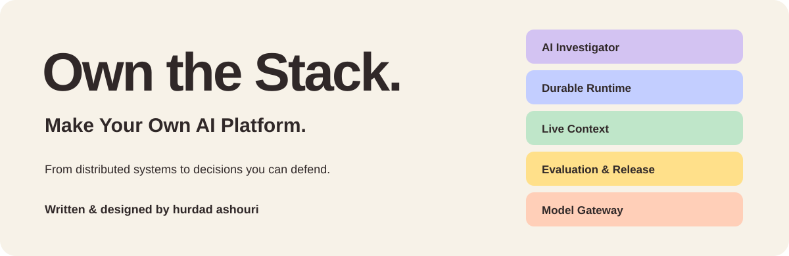

<div align="center">



**A distributed-systems study lab. An AI platform design workshop.**

<a href="#build-understanding-before-infrastructure"></a> <a href="LICENSE"></a> <a href="https://own-the-stack.vercel.app/"></a> <a href="https://own-the-stack.vercel.app/"></a>

14 chapters · 15 ADRs · Architecture & UML · Interactive walkthroughs

[**Explore the live site ↗**](https://own-the-stack.vercel.app/) &nbsp; · &nbsp; [**Enter the capstone**](https://own-the-stack.vercel.app/final-project/index.html#overview) &nbsp; · &nbsp; [**Play the developer POV**](https://own-the-stack.vercel.app/final-project/index.html#outcome)

Created, written and maintained by **[hurdad ashouri](https://github.com/Hurdadd)**

</div>

---

<div dir="rtl">

**از خواندن سیستم‌های توزیع‌شده تا طراحی پلتفرم AI خودت.**

اینجا فقط ابزارها را کنار هم نمی‌چینیم: اول مسئلهٔ توسعه‌دهنده را می‌فهمیم، بار و هزینه را تخمین می‌زنیم، برای تصمیم‌ها دلیل می‌آوریم و مسیر اجرا و بازیابی را رسم می‌کنیم. سایت برای همه باز است؛ مخزن GitHub فعلاً خصوصی می‌ماند.

</div>

## Build understanding before infrastructure

Own the Stack connects fourteen chapters of distributed-systems study to one
reusable AI platform design. A developer should be able to define an AI app,
submit a run, inspect its evidence and trace, and understand how it recovers when
something fails. **Incident Investigator** is the first proposed application.

> **What you can use today:** the bilingual educational website, design workshop,
> calculators, architecture/UML diagrams and local animated walkthroughs.
> The platform APIs, workers, database, CDC, model serving, real evaluations and
> disaster-recovery automation are **not implemented yet**.

## Start your journey

| Step | Explore | What you get |
| :--- | :--- | :--- |
| **01 · Understand** | [Project overview](https://own-the-stack.vercel.app/final-project/index.html#overview) | The developer, the problem, inputs/outputs and the first slice |
| **02 · Estimate** | [Workload & cost](https://own-the-stack.vercel.app/final-project/index.html#estimates) | Editable arithmetic, 12 assumptions and explicit limits |
| **03 · Decide** | [Architecture decisions](https://own-the-stack.vercel.app/final-project/index.html#decisions) | 15 ADRs with alternatives, rationale, validation and revisit triggers |
| **04 · Follow** | [Animated request flow](https://own-the-stack.vercel.app/final-project/index.html#architecture) | Trace a proposed request across the platform boundaries |
| **05 · Recover** | [RPO & RTO](https://own-the-stack.vercel.app/final-project/index.html#recovery) | Failure-specific targets, recovery budgets and planned drills |
| **06 · Experience** | [Developer POV](https://own-the-stack.vercel.app/final-project/index.html#outcome) | A synthetic seven-scene journey, including worker interruption and resume |

Want the foundations first? [Open the fourteen chapters](https://own-the-stack.vercel.app/#chapters).
For interview context, [browse the attributed evidence](https://own-the-stack.vercel.app/final-project/index.html#company-evidence): one official exercise and seven candidate accounts, with limitations shown.

## One platform, five capabilities

| Capability | Proposed responsibility |
| :--- | :--- |
| **Live Context** | Versioned, authorized data; retrieval freshness, CDC and deletion guards |
| **Durable Runtime** | Persisted runs and steps, retries, ownership fencing and cancellation |
| **AI Investigator** | Read-only incident investigation with evidence and uncertainty |
| **Evaluation & Release** | Frozen versions, datasets, trials and evidence-led promotion |
| **Model Gateway** | Provider adapters, budgets, deadlines, usage and a later local-serving phase |

The design starts with a small end-to-end slice. A cited-answer app should later
reuse the same core. Foundation-model training and a multi-GPU training scheduler
are outside the first slice.

## Recovery, with a reason behind every number

| Failure scenario | RPO objective | RTO objective | Claim boundary |
| :--- | :--- | :--- | :--- |
| Worker crash | **0** acknowledged state lost | **2 min** | Database and disk survive |
| Database / disk loss | **≤5 min** | **≤30 min** | Synthetic pilot ≤10GB; independent backup + WAL |
| Whole-region loss | **≤15 min** | **≤4 h** | Cold cross-region recovery; current IAM |
| Derived retrieval index | **0** authoritative data lost | **≤4 h** | Source intact; one-million-document scenario |

**Selected design objectives, not measured results or hosting SLAs.** Only the
audience decision is accepted; technical ADRs remain proposed.
[Read the contracts](final-project/recovery.json) · [See the drill guide](docs/RECOVERY.md)

## Try it locally

Python **3.10+** is enough. No API key or database is required.

```sh
git clone https://github.com/Hurdadd/own-the-stack.git
cd own-the-stack
python3 -m http.server 8766 --bind 127.0.0.1
```

Open **[localhost:8766](http://127.0.0.1:8766/)**. Cloning requires access to the
private repository; the [hosted website](https://own-the-stack.vercel.app/) is public.
Fonts load from Google Fonts with local fallbacks. Calculators and animations
send no model/platform requests. Motion is user-controlled, with pause, stepping,
keyboard support and reduced-motion behavior.

<details>
<summary><strong>Development & verification</strong></summary>

Committed HTML works as-is. After editing the capstone sources:

```sh
python3 assets/build_final_project.py
python3 assets/check_publication.py
python3 assets/check_final_project.py
python3 assets/structcheck.py index.html final-project/index.html
python3 assets/build_site.py
python3 assets/check_publication.py --export
```

The allowlisted `public/` export excludes credentials, local history, review
captures, generator state and tool caches. Frozen diagram exports and nine
export/specification hash pairs are checked by SHA-256; Archify is optional for regeneration.

For browser checks, start the local server, then use Node.js and installed Chrome:

```sh
npm ci
npm run test:browser
```

Set `BASE_URL` for another origin. For Playwright Chromium, run
`npx playwright install chromium` and set `PW_CHANNEL=chromium`.
Screenshots stay in the ignored review directory.

The Actions job is supplied at `.github/ci-templates/checks.yml` and is currently
**inactive**: enabling it requires a credential with `workflow` scope.
See [DEVELOPMENT](docs/DEVELOPMENT.md) for details.

</details>

<details>
<summary><strong>Repository map</strong></summary>

```text
assets/          shared styles, scripts, generators and checks
ch*/             fourteen bilingual chapters and diagrams
final-project/   capstone, ADRs, estimates, recovery and evidence ledgers
docs/            development, recovery, deployment and third-party notices
.github/         contribution templates and the inactive CI template
```

</details>

## Help shape the project

| Contribute | Understand the rules | Report a problem |
| :--- | :--- | :--- |
| [Contributing](CONTRIBUTING.md) | [Code of conduct](CODE_OF_CONDUCT.md) | [Support](SUPPORT.md) |
| [DCO sign-off](DCO) | [Governance](GOVERNANCE.md) | [Security policy](SECURITY.md) |

Keep proposals separate from implemented behavior and estimates separate from
observations. Attribute company/interview claims and preserve uncertainty.
Contributions require maintainer review and a `Signed-off-by` line under the DCO;
there is no CLA or mandatory copyright assignment. Repository access is by invitation.

## Availability & ownership

**Website: public. GitHub repository: private.** The production site opens without
Vercel login. Preview/generated deployment URLs retain Standard Protection.
See [deployment notes](docs/HOSTING.md) and [changelog](CHANGELOG.md).

Original work is © 2026 **hurdad ashouri**, licensed under
[**GNU AGPL-3.0-only**](LICENSE). Preserve notices and comply with applicable
source-sharing obligations when distributing or modifying covered work.

The study refers to *Designing Data-Intensive Applications, 2nd Edition*, by
Martin Kleppmann and Chris Riccomini. Book, font, diagram-component and linked-account
rights remain with their owners. See [NOTICE](NOTICE) and
[third-party notices](docs/THIRD_PARTY_NOTICES.md). This independent project is not
affiliated with O’Reilly or the companies mentioned in the evidence register.

---

<div align="center">

**Learn the trade-offs. Defend the decisions. Own the stack.**

[Visit the lab ↗](https://own-the-stack.vercel.app/)

</div>
