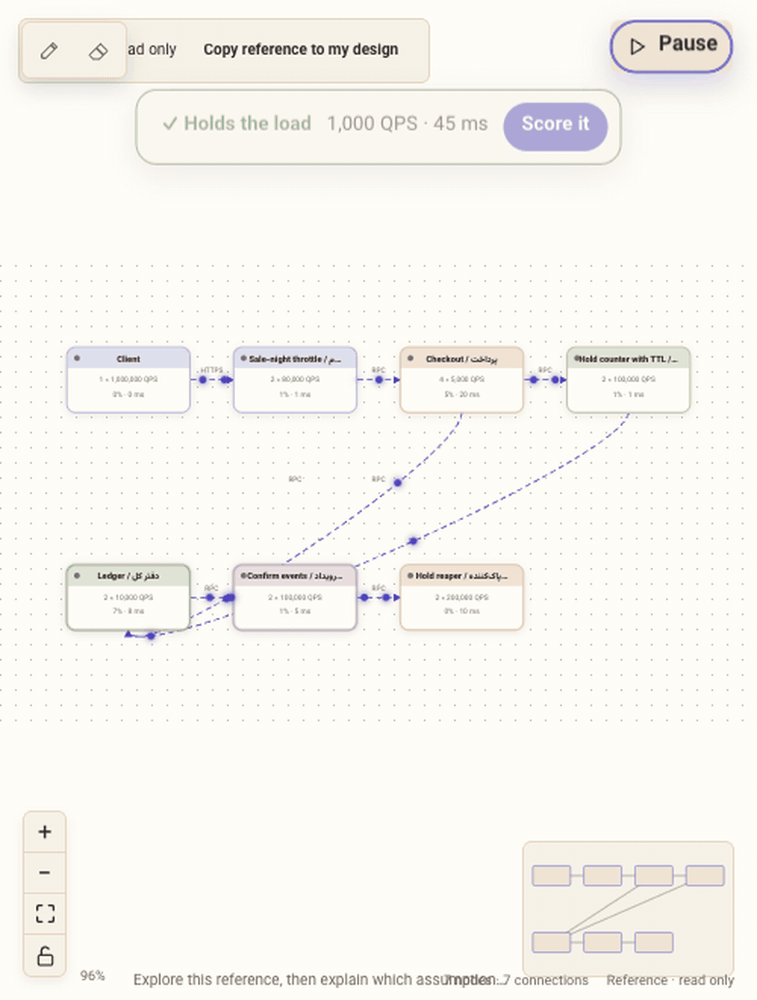
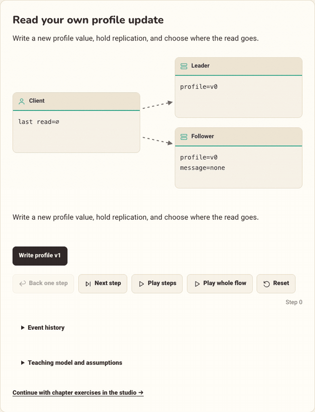

# Exercise studio and inline concept labs

Two learning tools sit on top of the DDIA reading experience. Both are static,
local-first and bilingual (Persian RTL / English), with light and dark themes.
All simulated numbers are educational assumptions, not infrastructure benchmarks.



## Run locally

```sh
python3 -m http.server 8766 --bind 127.0.0.1
```

Open [the studio](http://127.0.0.1:8766/studio/) or any chapter. No API key,
database or build step is needed.

## Inline concept labs (all 14 chapters)

Each chapter has 3 short experiments placed right after the section that explains
the concept (4 in chapter 6): **43 labs**. A lab is a small deterministic state
machine. You pick a decision, advance one event at a time and watch what survives
a crash, a retry or a lagging replica.



- Each lab uses one of four layouts (row, stack, fan, triangle) with animated links.
  A message bubble travels between nodes, changed values flash, failed nodes dim.
- Controls: **Next step**, **Play steps**, **Back one step**, **Reset** and
  **Play whole flow**, which plays up to four distinct scenarios start to finish.
- Every lab lists its teaching model and assumptions under the diagram.
- Source: `assets/concept-labs.js` (models), `assets/concept-labs.css`,
  `assets/build_concept_labs.py` (inserts each lab after its teaching section).
- Animations ignore the operating-system reduced-motion setting on purpose, because
  the motion is the content. Set `data-motion="off"` on `<html>` to switch them off.

## Studio workspace

- Choose one of **84 exercises**: 49 chapter exercises and 35 classic system-design problems.
- Add components, connect protocols and edit capacity, replicas and latency.
- **Run** (header, Simulate tab or the pill on the canvas) simulates the selected
  request rate. Packets move along every active edge, receiving nodes glow, and an
  overloaded node drops packets in red. A verdict card says whether the design holds
  the load, names the bottleneck, and offers **Score it**.
- **Step-by-step solution** (Task tab): one complete local walkthrough, with no AI
  involved: understand, clarify requirements, estimate load, build the components,
  trace a request, break it, and weigh the trade-offs. It can show the reference on
  the canvas or copy it into your design.
- Compare your design with the exercise-specific reference in its own read-only tab.
- Record tradeoffs, annotate the canvas, save designs, export or share them.
- Use the interview timer, the structural evaluation and the local progress dashboard.

Deep links used by the chapters: `studio/index.html?exercise=ch8-ex4` opens one
exercise and `studio/index.html?chapter=8` opens the first exercise of a chapter.

Evaluation is a transparent educational rubric. It cannot prove consistency,
correctness, production capacity or readiness for a particular interview level.
Several different designs can satisfy a brief. Reference designs are discussion
sketches, not the only accepted answer; read the linked worked solution too.

Saved designs and progress stay in this browser's local storage. They are not a
cloud account or a backup. Export JSON to keep a portable copy. A shared design
link carries the design in the URL fragment; it is not a live collaborative session.
Do not put private data into a design you share.

## Reference designs

The 49 chapter exercises each have their own reference topology, written in
`assets/exercise_references.py` (nodes, edges, a bilingual note). Replicas are sized
by `assets/size_references.cjs` so every reference carries the default 1000 QPS;
the result lands in `assets/reference_sizing.json`. The 35 classic problems keep
the reference topology of the public SysDes project they were adapted from.

## Build and verify

```sh
python3 assets/build_studio_data.py      # catalog: 38 components, 84 exercises
node assets/size_references.cjs          # only after editing exercise_references.py
python3 assets/build_concept_labs.py     # inserts the labs into the chapters
node assets/check_studio_engine.cjs
node assets/check_concept_labs.cjs
python3 assets/build_site.py
node assets/make_readme_gifs.cjs         # re-records docs/media/*.gif (needs ffmpeg and Chrome)
```

The studio is included in the allowlisted `public/` export; the README GIFs are not.

## Sources and boundaries

The studio's feature set was inspired by the public
[SysDes studio](https://system-dec.vercel.app/studio) and its
[source repository](https://github.com/subhm2004/SysDes). The DDIA implementation
(canvas, engine, labs, walkthrough, layout and styling) is original code for this
project's static, bilingual environment. The 35 classic problems and the component
catalog values are adapted from SysDes data, and that repository publishes no
licence file, so their reuse terms are not confirmed. Browser observations and
extracted evidence are kept as local development records, not published site content.
